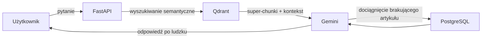
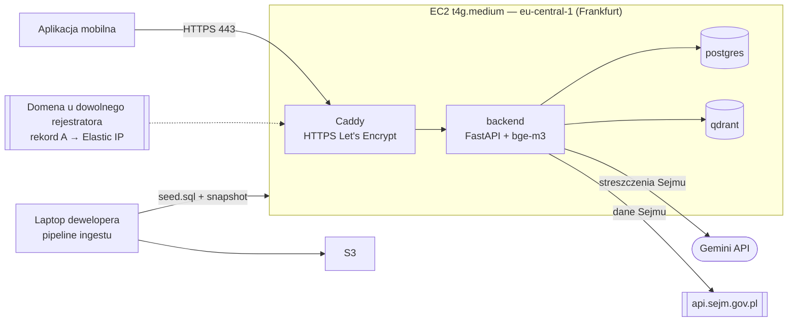

# Jakie dane i gdzie je przechowujemy

## Co przechowujemy

- **Dane z Sejmu** — posiedzenia, projekty ustaw i wyniki głosowań. Trzymamy ich kopię u siebie, bo API Sejmu jest wolne: pobieramy raz, potem aplikacja czyta już z naszej bazy.
- **Ustawy** — pocięte na artykuły: oryginalny tekst, streszczenie prostym językiem i odesłania do innych artykułów.
- **Wektory streszczeń artykułów** — do wyszukiwarki.
- **Teksty wygenerowane przez Gemini** (streszczenia, opisy posiedzeń) — zapisujemy je, żeby nie generować i nie płacić drugi raz.

Nie przechowujemy żadnych danych użytkowników (brak kont).

## Gdzie

| Magazyn | Co trzyma |
|---|---|
| **PostgreSQL** | Dane z Sejmu, ustawy i artykuły, teksty od Gemini |
| **Qdrant** | Wektory do wyszukiwania |
| **S3** | Backupy baz i pliki źródłowe ustaw (PDF) |

## RAG (z `proste-fakty`)

- **Szybka ścieżka — Qdrant.** Super-chunki: główny artykuł wzbogacony o kontekst artykułów powiązanych. W ok. 90% przypadków daje LLM-owi cały potrzebny kontekst.
- **Ścieżka awaryjna — PostgreSQL.** Surowe, pocięte artykuły z unikalnym identyfikatorem (slug). Gdy w super-chunku jest odesłanie do innej ustawy, model dociąga brakujący artykuł przez Function Calling.

## Na AWS

Zasada: **jedna maszyna EC2 z tym samym `docker compose` co lokalnie** (Postgres + Qdrant + backend + Caddy), bez usług zarządzanych. Danych jest mało (seed: ~10 tys. wierszy, snapshot Qdranta ~0,5 MB), ruch mały, więc RDS, Qdrant Cloud czy load balancer to koszt bez zysku.

### Elementy

| Element | Wybór |
|---|---|
| Maszyna | **EC2 `t4g.medium`** (2 vCPU Graviton/ARM, 4 GB RAM), Ubuntu 24.04 arm64 |
| Tryb kredytów CPU | **`standard`** (nie `unlimited`) |
| Region | `eu-central-1` (Frankfurt) |
| Dysk | **EBS gp3, 30 GB** |
| Adres | **Elastic IP** |
| Firewall | Security group: 80, 443 z całego świata, 22 tylko z naszych IP |
| Postgres | Kontener `postgres:17` |
| Qdrant | Kontener `qdrant/qdrant:v1.19.1` |
| HTTPS | Caddy w compose, certyfikat Let's Encrypt |
| Domena / DNS | Dowolny rejestrator, rekord A → Elastic IP |
| Backup | Cron: `db/dump.sh` → `aws s3 cp` do S3; dostęp przez **rolę IAM** maszyny |
| Ingest | **Na laptopie**, nie na serwerze |

